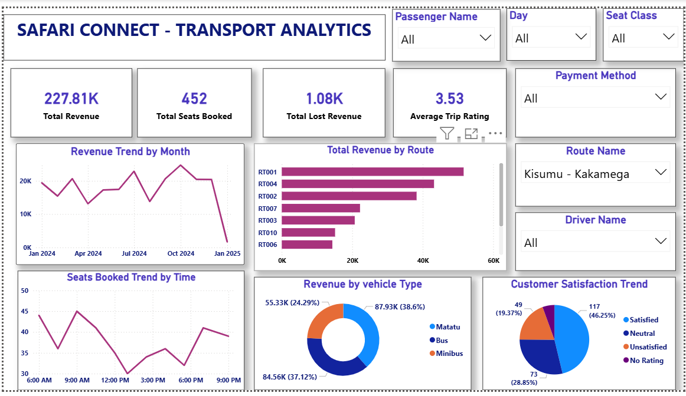
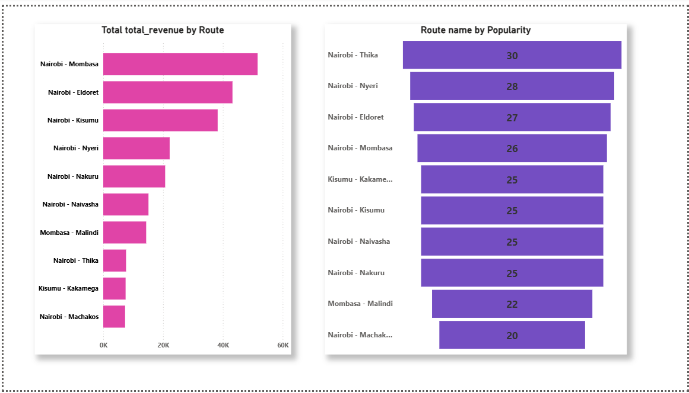
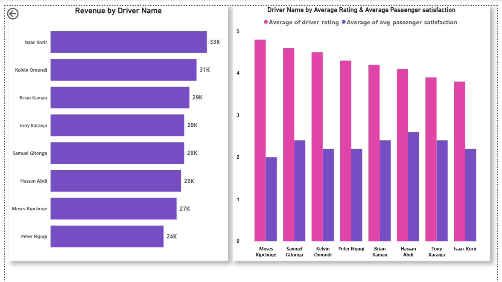
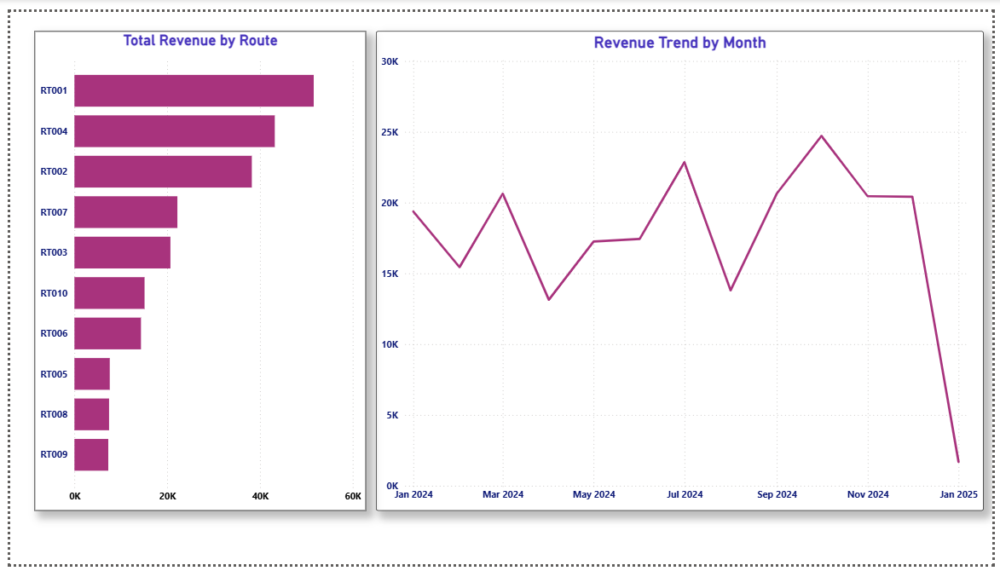
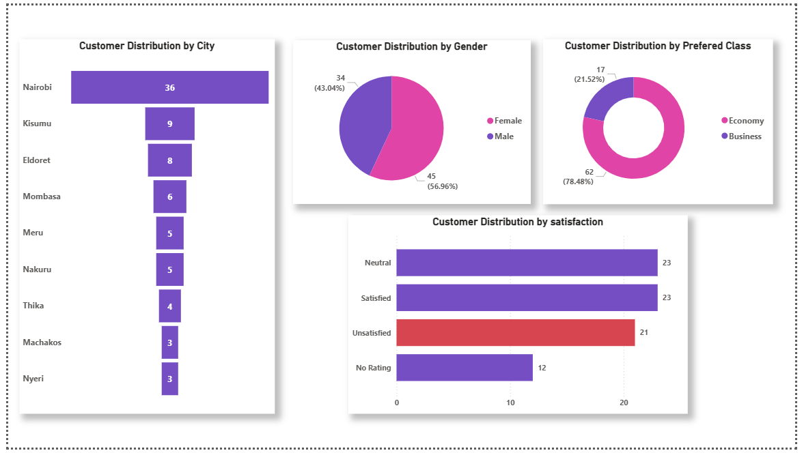
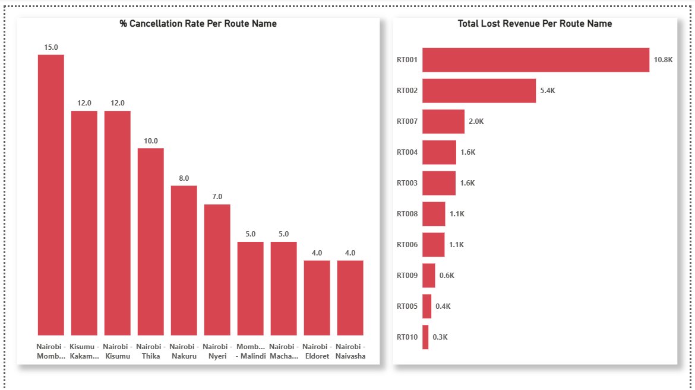
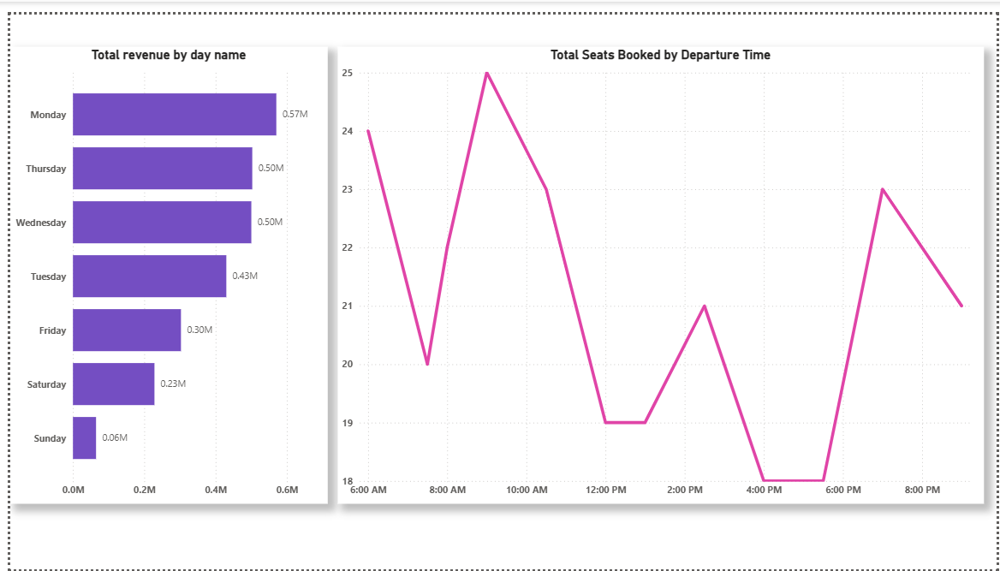

# Safari Connect: Transport Booking Analysis (PostgreSQL + Power BI)

An end-to-end data analytics project: cleaning a messy booking dataset in PostgreSQL, answering six business questions with SQL views, and presenting the results in an interactive Power BI dashboard.

**Tools:** PostgreSQL · SQL (CTEs, window functions, views) · Power BI · DAX

---

## Business Context

Safari Connect is a Kenyan passenger transport company running routes across the country. Management wanted to understand which routes and drivers perform best, how revenue is trending, who the passengers are, what cancellations cost, and when demand peaks. The raw booking data was exported as a CSV with inconsistent formatting, so it had to be cleaned before any analysis.

> See `docs/SafariConnect_Project_Brief.docx` for the full brief.

## Business Questions

| # | Area | Question |
|---|------|----------|
| 1 | Route analysis | Which routes earn the most, which are most popular, and which are most efficient per seat sold? |
| 2 | Driver performance | Who are the best drivers, and does driver rating relate to passenger satisfaction? |
| 3 | Revenue trends | How does revenue change month by month, and what are the best and worst months? |
| 4 | Passenger insights | Where do passengers come from, which seat class do they prefer, and are they satisfied? |
| 5 | Cancellations | What is the cancellation rate per route, and how much revenue was lost? |
| 6 | Operational patterns | What are the busiest days and times, and when should more vehicles be added? |

## Project Workflow

```
safari_connect_dirty.csv
        │  import
        ▼
bookings_staging (all TEXT columns)   ← cleaning happens here
        │  typed INSERT
        ▼
bookings (production table, correct data types + primary key)
        │
        ▼
v_clean_trips (completed bookings + derived columns)
        │
        ▼
6 analysis views  →  Power BI dashboard
```

## Repository Structure

```
├── data/        Raw dirty CSV
├── sql/         Three SQL scripts, run in order
├── powerbi/     Power BI report (.pbix)
└── images/      Dashboard screenshots
```

## SQL Scripts

Run these in order.

**1. `01_staging_and_cleaning.sql`**
Creates the `safari_connect` schema and a staging table with every column as `TEXT`, so the dirty CSV loads without errors. Cleaning steps:

- Trimmed whitespace and fixed name casing (`INITCAP`)
- Standardised gender values (`F`, `M`, `female` → `Female` / `Male`)
- Standardised seat class, payment method, booking status and vehicle type
- Cleaned phone numbers (removed dashes, restored leading zeros)
- Stripped `KES` and other text from fare columns
- Nulled out invalid trip ratings and invalid seat counts
- Filled blank passenger cities
- Converted mixed date formats (`MM/DD/YYYY`, `DD/MM/YYYY`, `DD-MM-YY`) to ISO format
- Removed duplicate `booking_id` rows

**2. `02_production_table.sql`**
Creates the `bookings` table with proper data types and a primary key, then loads the cleaned staging data into it, with final type casting and validation filters.

**3. `03_business_analysis.sql`**
Builds `v_clean_trips` (completed bookings plus derived columns such as travel month, day name and satisfaction group), then one view per business question:

| View | Answers |
|------|---------|
| `v_route_analysis` | Q1: revenue, popularity and efficiency per route |
| `v_driver_perfomance` | Q2: driver revenue, rating and passenger satisfaction |
| `v_revenue_trend` | Q3: month-over-month change and % growth |
| `v_passenger_insights` | Q4: city, gender, seat class and satisfaction breakdown |
| `v_cancellation_analysis` | Q5: cancellation rate and lost revenue per route |
| `v_operational_patterns` | Q6: bookings and revenue by day and departure time |

Views are saved queries in the database, so Power BI always reads the latest data through them.

## Dashboard

Power BI connects to PostgreSQL and imports the views above. Each business question has its own report page, plus an overview dashboard with KPIs built using DAX measures.

### Overview


KPI cards for total revenue, seats booked, lost revenue and average trip rating, with revenue trend, revenue by route and vehicle type, and customer satisfaction.

### Route analysis


Nairobi - Mombasa earns the most, while Nairobi - Thika is the most popular route by bookings.

### Driver performance


Revenue by driver, compared with each driver's average rating and average passenger satisfaction.

### Revenue trends


Monthly revenue from January 2024 to January 2025.

### Passenger insights


Where passengers come from, their gender split, preferred seat class and satisfaction.

### Cancellations


Cancellation rate and lost revenue per route.

### Operational patterns


Revenue by day of the week and seats booked by departure time.

## Key Findings

Figures below are read from the dashboard; amounts are in KES.

- **Overall:** total revenue of KES 227.81K from 253 completed bookings and 452 seats, with an average trip rating of 3.53. By vehicle type, matatus bring in 38.6% of revenue, buses 37.1% and minibuses 24.3%.
- **Routes:** Nairobi - Mombasa is the top earner at about KES 51K, followed by Nairobi - Eldoret (about KES 43K) and Nairobi - Kisumu (about KES 38K). Nairobi - Machakos is the weakest at about KES 7K. Nairobi - Thika is the most popular route (30 bookings) but earns far less than the long-distance routes, so popularity does not mean revenue.
- **Drivers:** Isaac Korir generates the most revenue (about KES 33K) but has the lowest rating (3.8). Kelvin Omondi is second on revenue (about KES 31K) with a 4.5 rating, the third highest. Moses Kipchoge has the top rating (4.8) but the lowest passenger satisfaction score. Driver rating does not track passenger satisfaction.
- **Revenue trend:** monthly revenue moves between roughly KES 13K and KES 25K through 2024, with no steady growth. The best month is October 2024 (about KES 24.7K) and the weakest full month is April 2024 (about KES 13K). January 2025 drops sharply, which likely reflects incomplete data for that month.
- **Passengers:** the 79 passengers are mostly from Nairobi (36, about 46%), then Kisumu (9) and Eldoret (8). 57% are female and 43% male, and 78% prefer Economy class. Across completed bookings, 46% are rated satisfied, 29% neutral and 19% unsatisfied.
- **Cancellations:** Nairobi - Mombasa has the highest cancellation rate (15%) and the biggest loss (about KES 10.8K), followed by Kisumu - Kakamega and Nairobi - Kisumu at 12% each. Across all routes, cancellations cost roughly KES 24.9K.
- **Peak period:** seats booked peak at about 9:00 am, with a second peak around 7:00 pm, and are lowest between 4:00 and 5:30 pm. Monday, Wednesday and Thursday are the strongest days for revenue, and Sunday is the weakest.

## Recommendations

1. **Introduce a cancellation policy on Nairobi - Mombasa.** It has the highest cancellation rate (15%) and the largest lost revenue (about KES 10.8K). Options include a deposit or tiered cancellation fee, reminders before departure, and a waitlist to resell cancelled seats. Apply the same policy to Kisumu - Kakamega and Nairobi - Kisumu (12% each).
2. **Promote Kelvin Omondi and coach Isaac Korir.** Kelvin combines top-three rating (4.5) with second-highest revenue (about KES 31K). Isaac earns the most but has the lowest rating (3.8), so customer-service coaching would protect that revenue.
3. **Add vehicles around the morning peak.** Demand peaks at about 9:00 am and is strongest from Monday to Thursday, while Sunday and mid-afternoon departures are quiet. Move capacity to the peak and test promotions for the quiet periods.
4. **Review pricing on Nairobi - Thika.** It is the most popular route but earns little, so a fare review or higher-capacity vehicles could improve revenue per seat.

## How to Reproduce

1. Create a PostgreSQL database and run `01_staging_and_cleaning.sql` up to the table creation.
2. Import `data/safari_connect_dirty.csv` into `safari_connect.bookings_staging`.
3. Run the cleaning section of script 1, then `02_production_table.sql`, then `03_business_analysis.sql`.
4. Open `powerbi/safari_powerbi.pbix` and update the data source to point to your database.
